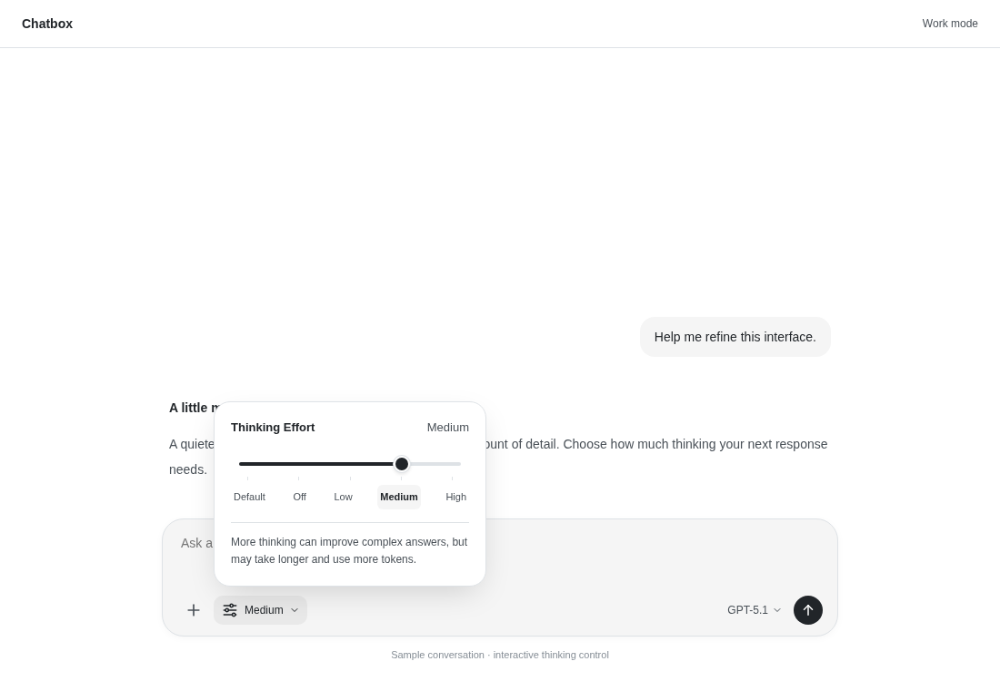
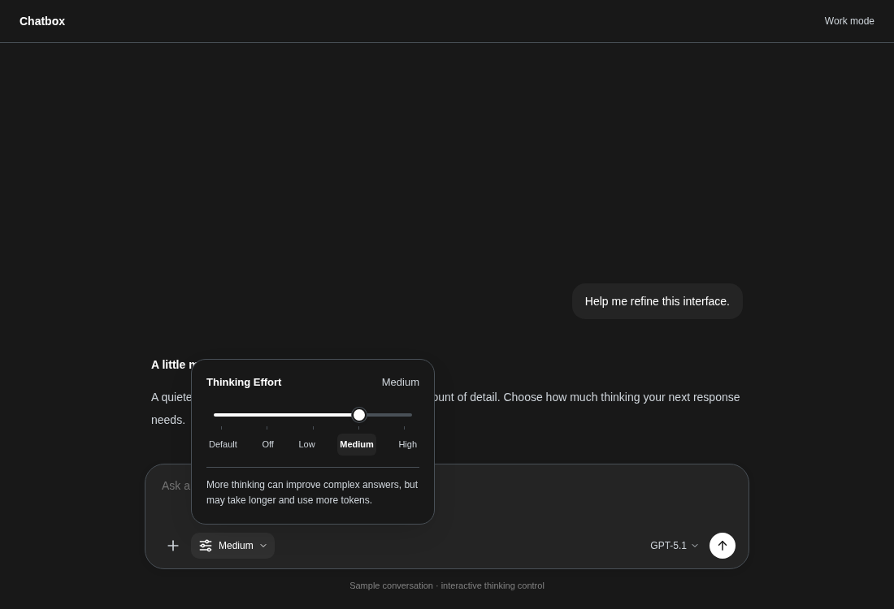
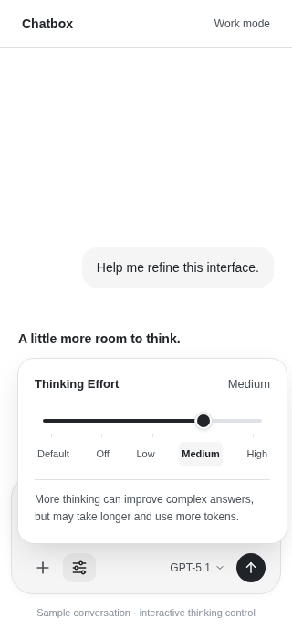

# Thinking effort slider

The composer now shows the selected thinking level beside a compact control.
Opening it reveals a discrete slider, clickable level labels, and a short
explanation of the current setting. The neutral track, small thumb, restrained
shadow and rounded panel take inspiration from the Codex effort picker.

## Design reference

- [Public Codex effort-picker screenshots and discussion](https://community.openai.com/t/new-astra-light-model-in-codex-is-confusing-and-it-costed-me-lot-of-tokens/1402319)
- [Codex app overview](https://openai.com/index/introducing-the-codex-app/)

This is an original Chatbox implementation, not imported Codex source or assets.
It uses Chatbox's theme tokens, translations, capability detection, and existing
provider-option conversion. It does not introduce additional reasoning levels.

## Behavior

- Only the selected model's supported settings appear. Toggle-only models retain
  Default / Off / On, while effort models offer their existing Low / Medium / High.
- Default remains distinct from Off: Default sends no override; Off explicitly
  disables thinking where the model supports that operation. The explanation
  makes clear that Default is the model's own setting, not a minimum effort level.
- Pointer/touch dragging, clicking a level, arrow keys, Home and End all select
  discrete settings. Escape dismisses the popover and focus returns to its trigger.
- The narrow-screen toolbar keeps an icon-only trigger with an accessible label.
  The popover fits a 320px viewport. Native range semantics and a translated
  `aria-valuetext` expose the selected level to assistive technologies.
- The shared composer/pending-action surface gains a 24px corner radius, slightly
  more padding, a thin border, and a softer shadow.
- General Settings → Color Presets → **Codex Neutral** applies an optional
  monochrome light/dark palette throughout Chatbox. Existing colors remain selected
  until the user chooses the new preset.

## Preview

Run `pnpm storybook` and open **Real Components / Reasoning Control** for interactive
Light, Dark and Mobile stories. The screenshots below use the real control and
shared composer surface with sample surrounding conversation content; they are
component previews, not screenshots of the full desktop application.

### Light

### Dark

### Mobile (320px)

## Validation

- 123 tests pass across seven targeted Vitest suites (Node 22), covering the
  component, reasoning state, provider mapping, theme presets, and neighboring
  composer controls.
- TypeScript application checking passes.
- The production renderer build passes with a 5120 MB Node heap. The initial
  direct invocation exhausted the default 2 GB heap; rerunning with the same
  heap allowance configured in the repository’s `.npmrc` completed successfully.
- Chromium checks keyboard selection, Escape dismissal, clickable stops, and the
  light/dark and 320px layouts.
